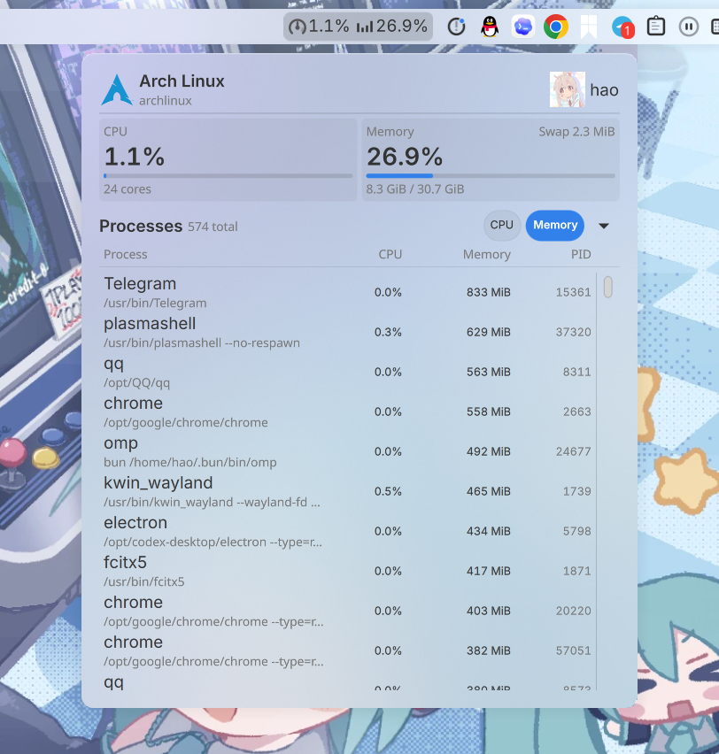

<div align="center">
  <h1 align="center">kde-perfmon</h1>
  <p align="center">KDE Plasma 6 面板性能监视器：CPU / 内存预览、进程列表与系统状态头</p>
  <p align="center"><a href="README.en.md">English</a> | 中文</p>

  <a href="https://github.com/haoyn231/kde-perfmon/releases/latest"></a>
  <a href="./LICENSE"></a>
  
  
  
  
  <br>
  <a href="https://github.com/haoyn231/kde-perfmon/actions/workflows/ci.yml"></a>
  <a href="https://github.com/haoyn231/kde-perfmon/stargazers"></a>
</div>

---

<p align="center">
  
</p>

<p align="center"><sub>面板中的 CPU / 内存预览，以及按内存排序的进程列表</sub></p>

KDE Plasma 6 面板小程序（Plasmoid）：在菜单栏预览 CPU 与内存占用，点开后查看每个进程的占用，并可按 CPU 或内存排序。顶部展示发行版 logo、发行版名、主机名、用户头像与用户名，配色完全跟随系统明暗主题。

实现参考了开源项目 [DankMaterialShell (DMS)](https://github.com/AvengeMedia/DankMaterialShell) 的 `MonitorPill` / `ProcessSummary` / `ProcessesView` / `ProcessSystemHeader`，以及 [dgop](https://github.com/AvengeMedia/dgop) 的采样语义。

## 功能

- 面板中显示两段「图标 + 百分比」：CPU、内存
- 点击 CPU 数字：按 CPU 占用打开进程列表；点击内存数字：按内存占用打开
- 弹窗顶部：发行版 logo、发行版名、主机名，右侧用户头像与用户名
- 弹窗内提供 `CPU` / `Memory` 排序按钮，再点当前按钮切换升/降序，箭头按钮也可切换
- 进程行：名称、完整命令行（省略显示）、CPU%、RSS、PID（不显示进程图标）
- 点击进程行展开完整命令行、PPID 与内存占比，可发送 SIGTERM 或 SIGKILL（强制终止仅对 PID > 1000 开放，操作前需确认）
- 弹窗列表每秒刷新时保持滚动位置；PID 列不会被叠加式滚动条遮挡
- 弹窗关闭时只采样整机 CPU / 内存，不扫描进程，降低开销
- 全部颜色绑定 `Kirigami.Theme`，明暗配色切换即时生效

## 安装（KDE Plasma 6）

### 方式一：从 Release 安装（推荐）

Release 包内是**已经编译好**的插件，普通用户不需要安装编译工具。

1. 系统要求：KDE Plasma 6（Qt 6.5+）、Kirigami（Plasma 自带）。发布包在 Arch Linux / Plasma 6.8 / Qt 6.12 上构建；其它发行版如果插件加载失败，请改用「方式二」从源码构建。
2. 从 [Releases](https://github.com/haoyn231/kde-perfmon/releases) 下载 `kde-perfmon-vX.Y.Z.tar.gz` 和对应的 `.sha256` 文件，并校验：
   ```bash
   sha256sum -c kde-perfmon-v1.0.0.tar.gz.sha256
   ```
3. 解压到当前用户的 Plasma 小程序目录：
   ```bash
   mkdir -p ~/.local/share/plasma/plasmoids
   tar -xzf kde-perfmon-v1.0.0.tar.gz -C ~/.local/share/plasma/plasmoids
   ```
   解压后应存在：
   ```
   ~/.local/share/plasma/plasmoids/org.hao.perfmon/metadata.json
   ~/.local/share/plasma/plasmoids/org.hao.perfmon/contents/lib/Hao/PerfMon/libperfmonplugin.so
   ```
4. 让 Plasma 重新加载插件（首次安装通常已经能识别，升级后建议执行）：
   ```bash
   systemctl --user restart plasma-plasmashell.service
   ```
   也可以注销后重新登录。
5. 添加小组件：右键面板 → **进入编辑模式**（或「添加小组件」）→ 搜索 **性能监视器** / **Performance Monitor** → 拖到面板上。
6. 点击面板中的 CPU 百分比或内存百分比，即可打开进程列表。

卸载：
```bash
rm -rf ~/.local/share/plasma/plasmoids/org.hao.perfmon
systemctl --user restart plasma-plasmashell.service
```

### 方式二：从源码构建

依赖（Arch Linux）：

```bash
sudo pacman -S --needed base-devel cmake qt6-base qt6-declarative qt6-svg
```

构建并安装到当前用户：

```bash
git clone https://github.com/haoyn231/kde-perfmon.git
cd kde-perfmon
./install.sh
systemctl --user restart plasma-plasmashell.service
```

然后按「方式一」的第 5 步把「性能监视器」添加到面板。

## 使用

- 面板中的两个数字分别表示 CPU 与内存占用。
- 点击 CPU 数字会先按 CPU 排序再打开；点击内存数字会先按内存排序再打开。
- 弹窗内：
  - 点击 `CPU` / `Memory` 切换排序列；
  - 再次点击当前列，切换升序 / 降序；
  - 右侧箭头按钮切换当前列的排序方向；
  - 鼠标滚轮滚动进程列表。

## 数据语义

每秒采样一次，数据全部来自 `/proc`，不需要额外守护进程：

| 指标 | 计算方式 |
| --- | --- |
| 整机 CPU | `/proc/stat` 两次采样差值，`(total - idle - iowait) / total` |
| 进程 CPU | `Δ(utime+stime) / Δt / HZ / CPU核数 * 100`，上限 100%，即 100% = 整机满载（与 dgop 一致） |
| 进程内存 | RSS（`/proc/<pid>/stat` 的 rss 字段），按 RSS 字节数排序 |
| 系统内存已用 | `total - free - buffers - (Cached + SReclaimable - Shmem)`，与 gopsutil / DMS 一致 |
| 交换分区 | `SwapTotal - SwapFree` |

排序规则与 DMS 一致：切换列时从降序开始，再点同一列切换方向；数值相同时按 PID 升序。

## 系统信息头

- 发行版名 / ID / LOGO 来自 `/etc/os-release`
- 发行版 logo 优先查找 `/usr/share/pixmaps/<id>-logo.svg|png`（Arch 自带 `archlinux-logo.svg`），其次用图标主题里的 `distributor-logo-<id>`，最后回退 `computer-symbolic`
- 头像依次查找 `/var/lib/AccountsService/icons/$USER`、`~/.face`、`~/.face.icon`、`/usr/share/sddm/faces/$USER.face.icon`，都没有时显示 `user-identity-symbolic`
- 用户名来自 `getpwuid`，主机名来自 `QSysInfo::machineHostName()`
- 头像按圆形裁切，文字与底色全部跟随主题

## 主题

没有写死任何前景色或背景色：

- 文字：`Kirigami.Theme.textColor` / `disabledTextColor`
- 卡片、排序按钮底色：由 `textColor` 派生出的低透明度叠加
- 强调色：`Kirigami.Theme.highlightColor`（跟随 KDE 强调色）
- 高负载阈值：`neutralTextColor` / `negativeTextColor`

已在运行期间从 `OrchisDark` 切换到 `BreezeLight` 并切回，界面颜色会即时更新。

## 开发与测试

```bash
cmake -S . -B build -DCMAKE_BUILD_TYPE=Release
cmake --build build -j"$(nproc)"

# 单元测试 + 真实 /proc 采样测试
./build/perfmon-tests

# QML 静态检查（Arch 上 Qt6 版位于 /usr/lib/qt6/bin/qmllint）
/usr/lib/qt6/bin/qmllint -I package/contents/lib package/contents/ui/*.qml

# 不依赖面板，直接把真实弹窗 QML 渲染成 PNG（同时打印文本与主题颜色）
QT_QPA_PLATFORMTHEME=KDE QT_QPA_PLATFORM=offscreen QT_QUICK_BACKEND=software \
    ./build/perfmon-preview package/contents/ui/FullRepresentation.qml /tmp/preview
```

CI 在 Arch Linux 容器中安装 Qt 6 / Kirigami / libplasma，执行构建、单元测试、`qmllint` 和离屏渲染。推送 `v*.*.*` 形式的 tag（例如 `v1.0.0`）会触发 Release 工作流，自动构建并上传可直接安装的插件包与 SHA-256 校验文件。

目录结构：

```
src/
  procdata.{h,cpp}       /proc 解析、CPU 百分比、排序（可单测）
  processmodel.{h,cpp}   进程列表 QAbstractListModel
  perfbackend.{h,cpp}    1 秒定时采样、排序状态、系统信息、QML 属性/方法
  perfmonplugin.cpp      QML 扩展插件（导出 PerfBackend 单例）
package/
  metadata.json          Plasma 小程序元数据
  contents/ui/           main / 面板 / 弹窗 / 进程行 / 排序按钮 / 卡片
  contents/lib/Hao/PerfMon/  qmldir + 构建出的插件 .so
tests/tests.cpp          QtTest 单元测试 + 实机采样断言
tools/preview.cpp        离屏渲染调试工具
ci/arch-build.sh        CI / Release 共用的 Arch 容器构建脚本
.github/workflows/      ci.yml + release.yml
docs/releases/          每个版本的 Release 文档与通用模板
```

## License

MIT，见 [LICENSE](LICENSE)。
